# Determine a moda dos elemntos de cada conjunto:

- A) {12, 13, 14, 12, 16} -> *Moda* = 12
    A moda é 12 pois é o numero que mais repete nesse conjunto de valores. 
- B) {1,3,4,1,3,2,3,1,4,5} -> {1,1,1,3,3,3,4,4,5} **Bimodal** = 1 e 3
    Bimodal porque existe duas modas com a mesma quantidade de repetições. 

- C) {1,1,2,3,2,3,5,5} -> {1,1,2,2,3,3,5,5,} não tem moda. = **Amodal**
    Nesse caso não existe moda, pois não tem nem um valor se destancando

    obs: Se um conjunto de numero tiver mais de 3 modas, chamamos de **multimodal**

# Média, moda e Mediana

## Determine a moda, a mediana e media aritmética dos elemntos do conjunto:

Rol = 11,11,12,14,15,16
Mo = 11
Me = (12 + 14) / 2 = 13
Ma = (11+11+12+14+15+16) = 79/6 = 13,2

# População e Amostra

- População: é o conjunto total de elelmentos sobre os quais desejamos obter informações. Esses elementos Podem ser pessas, animais, plantas, objetos ou qualquer outra coisa de interesse da pesquisa. 
- Amostra: é uma parte da população selecionada para o estudo, com o objetivo de obter informações sobre o total.

# Amplitude

- A amplitude é a diferença entre o maior e o menos elementos do conjunto de dados objetivos na pesquisa.

Exemplo: 

- {(3,5),(4,0),(6,5),(6,5),(9,0),(9,5)} -> menor nota 3,5 - maior nota 9,5 = amplitude de 6,0

Exemplo de temperatura

A temperatura mínima doi de 22°C e a temperatura máxima doi de 35°C. Qual foi a variação da temperatura? 

Maior - menor = amplitude
35 - 22 = 13°C

# Variáveis

- No universo estatístico, a variável pode ser entendida como uma classificação, medida ou quantidade de resultados possíveis. 
- As varáveis podem ser **qualitativas** ou  **quantitativas**
- variável qualitativa: quando seus valores não são numéricos, e sim escolhas ou preferências. 
- variáveis quantitativas: quando seus valors são numéricos.

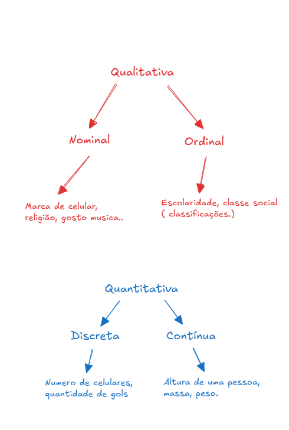

# Deternístico x Probabilísticos

- Os **febômenos determinísticos** são aqueles em que os resultados sã sempre os mesmo, qualquer que seja o número de ocorrência dos mesmmos.

- Nos **fenômenos aleatórios**, os resultados não serão previsíveis, mesmo que haja um grande número de repetições do mesmo fenômenos. 

- Experimento aleatório: Resultados imprevisíveis, mesmo em condições "iguais";
    - Cada experimento pode ser repetido indefinidamente;
    - Possíveos resultados conhecidos;
    - Resultado final desconhecido;

## Espaço amostral
O espaço amostral (S) de um experimento aleatório é o conjunto formado por todos os resultados possiveis desse experimento

## Evento aleatório
o evento aleatório (E) é um subconjunto do espaço amostral (S).

- **Experimento Aleatório**: Lançamento de uma dado. 
- **Espaço Amostral (S)**: S = {1,2,3,4,5,6}
- **Evento Aleatório (E)**: Par -> E = {2,4,6} 

# Espaços Equipováveis

Em um **espaço equiprovável** temos que todos os pontos amostrais dentro  dele têm a mesma chance de ocorrer.

# Definição da probabilidade

- A probabilidade de um evento E, denotada por P(E), é um número de 0 a 1 que indica a chance de ocorrência do evento E.

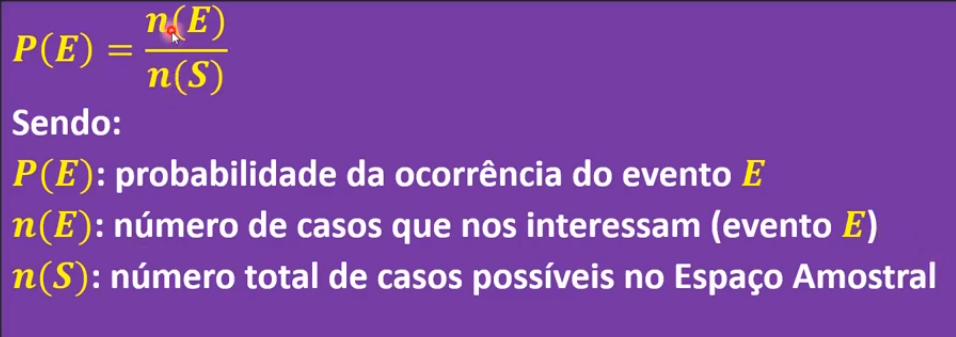

O Evento (E) é um subconjunto de um espaço amostral (S)

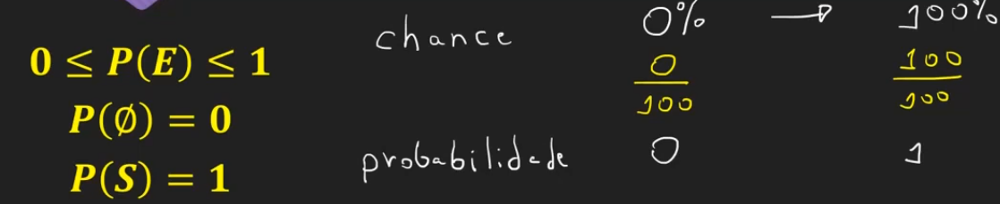

- Qual é a probabilidade de sair o número de 3 em um lançamento de um dado não viciado com 6 faces?

S = {1,2,3,4,5,6}
E = {3}

P(E) = n(E) / n(S) = 1/6

- Qual a probabilidade de sair um número menor que 3 em um lançamento de um dado não viciado de 6 faces?

S = {1,2,3,4,5,6}
E = {1,2}

P(E) = n(E) / n(S) = 2/6 = 1/3 = 0,33

# Teorema da Soma

Em um experimento aleatório de espaço amostral S, dados dois eventos A, B &sub; S, temos que:

P(A &cup; B) = P(A) + P(B) - P(A &cap; B)

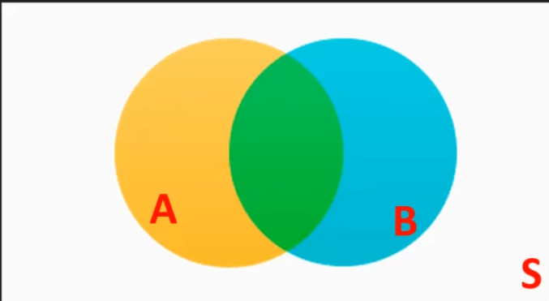

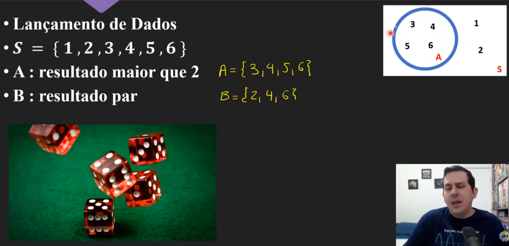

Lançamento de dados
S = {1,2,3,4,5,6}
A = {3,4,5,6}
B = {2,4,6}

P (A) = 4/6 = 2/3 = 0,67 ou 67%
P(B) = 3/6  = 1/2 = 0,5 ou 50%

### União
A &cup; B = {2,3,4,5,6}
P(A &cup; B) = 5/6 = 0,83 = 83%

### intersecção
A &cap; B = {4,6}
P(A &cap; B) = 2/6 = 1/3 = 0,33 = 33%

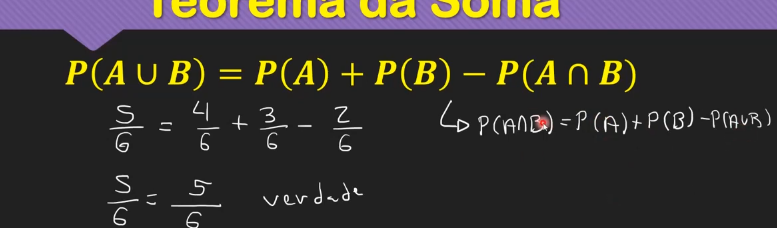

## Eventos Mutuamente excludentes

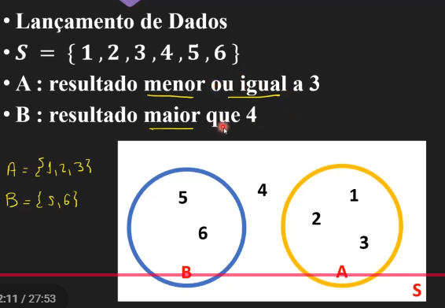
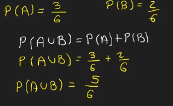

## Teorema da soma com 3 eventos
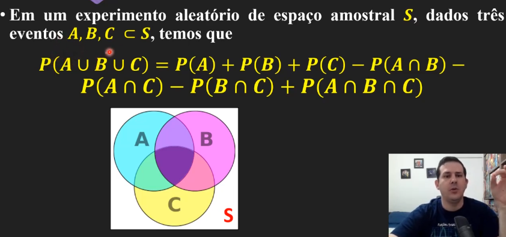

# Probabilidade de evento complementar
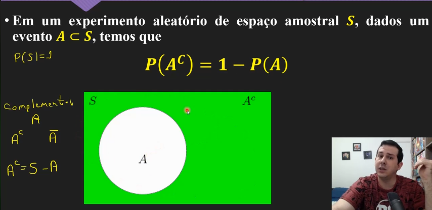
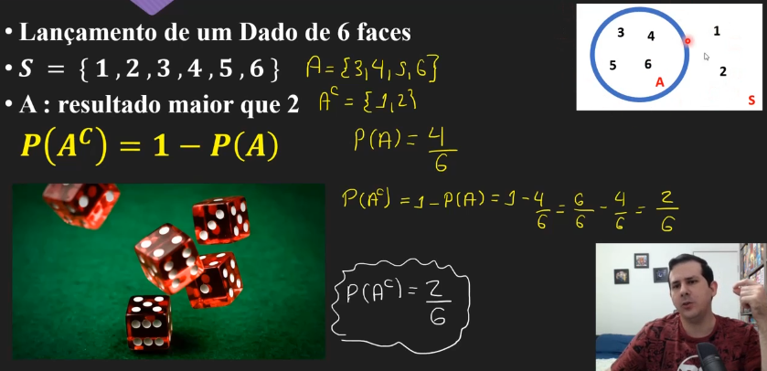

Exercício - 1° Forma
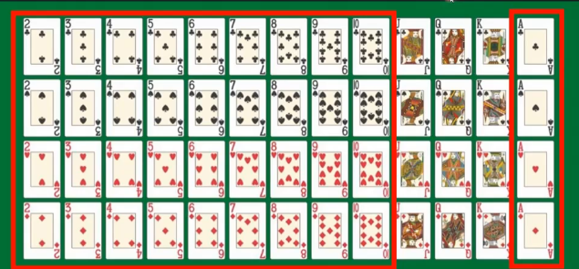
A: carta de número ou A

P(A) = 40/52 = 13/10

Exercício - 2° Forma
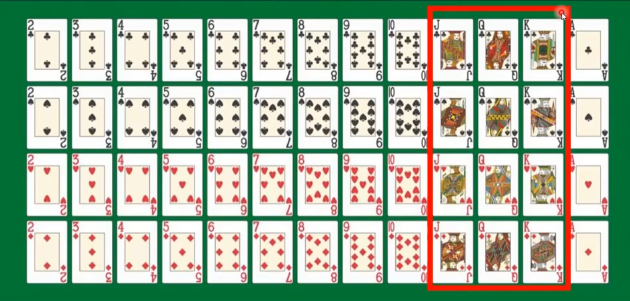

A: carta de figura

P(A) = 12/52
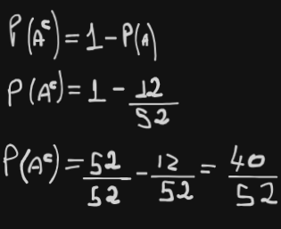

