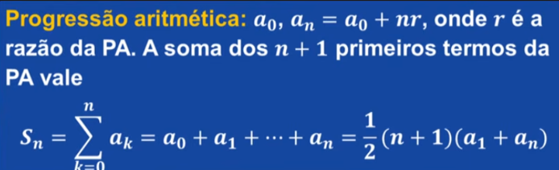

Parâmetro populacional

# Semana 1
## Exemplo 

Um exemplo de parâmetro populacional é a **altura média de todos os cidadãos de um país**, como a altura média de toda a população brasileira[1].

Outro exemplo é a **nota média final de todos os alunos** que já cursaram uma determinada disciplina em uma universidade, considerando a totalidade desses estudantes desde a criação do curso[2][3].

---

### **Por que esses são parâmetros populacionais?**

- **Definição de População:** A população é o conjunto universo de todos os elementos ou observações de interesse para a pesquisa (por exemplo, todos os peixes de uma bacia hidrográfica ou todos os alunos de um curso)[4].
- **Definição de Parâmetro:** É o valor numérico ou medida resumo que descreve uma característica calculada a partir de **todos** os elementos desse conjunto universo[1].
- **Diferença para a Amostra:** Se medíssemos a largura da nadadeira caudal de _todos_ os peixes de um rio, obteríamos o **parâmetro populacional**[2][4]. Como na prática é difícil medir todos os elementos, a estatística inferencial coleta dados de uma **amostra** (um subconjunto de peixes) para estimar esse parâmetro[1][2]. 

---

### **Resumo Prático para Fixar:**

- **População Inteira (100% dos dados):**
    - **Cálculo:** Feito sobre **todos** os indivíduos do grupo[2].
    - **Resultado:** **Parâmetro Populacional**[1].
    - _Exemplo:_ A média de altura de **todos** os jogadores de um time de futebol.
- **Amostra (Subconjunto dos dados):**
    - **Cálculo:** Feito sobre **parte** do grupo[3].
    - **Resultado:** **Estatística Amostral**[1].
    - _Exemplo:_ A média de renda de uma cidade calculada a partir de **500 moradores**[3].

## Dígitos significativos

Os **dígitos significativos** (ou algarismos significativos) indicam o grau de precisão e a confiabilidade de uma medição na análise estatística.

---

### **1. Incerteza Instrumental e Precisão**

- **Limitação dos Instrumentos:** Todas as medições físicas têm imprecisão intrínseca devido ao limite da escala do instrumento utilizado.
- **Dígito Incerto:** Os dígitos significativos representam todos os algarismos dos quais se tem certeza mais o **último dígito**, que carrega a incerteza da medição.
- **Diferença entre 7 cm e 7,0 cm
    - 7cm possui **1 dígito significativo**. A incerteza está na casa das unidades (pode ser qualquer valor entre 6,5 e 7,5.
    - 7,0 cm possui **2 dígitos significativos**. O número 7 é conhecido com certeza e a dúvida está no décimo de centímetro 0,0.

---

### **2. A Regra dos Zeros**

- **Zeros à Esquerda:** Servem apenas como mudança de escala/posição decimal e **não** são significativos.
    - Exemplo: \(0,001\) tem apenas **1 dígito significativo** (pode ser escrito como \(1 \times 10^{-3}\)).
- **Zeros à Direita (após a vírgula):** São significativos pois indicam maior precisão na medição.
    - Exemplo: \(0,100\) tem **3 dígitos significativos**.

---

### **3. Operações e Limitação pelo Dado Menos Preciso**

Ao combinar dados de medições diferentes em cálculos, **o resultado final não pode apresentar maior precisão do que a medição menos precisa**.

- **Exemplo de Cálculo de Área:**
    - Se uma parede mede \(2,65\text{ m}\) de altura (**3 dígitos significativos**) e \(3,2\text{ m}\) de largura (**2 dígitos significativos**), a multiplicação matemática gera \(8,48\text{ m}^2\).
    - No entanto, como o valor \(3,2\text{ m}\) limita a precisão da conta, o resultado final deve ser arredondado para ter apenas **2 dígitos significativos**: **\(8,5\text{ m}^2\)**.

---

### **4. Arredondamento ao Final dos Cálculos**

Para evitar a propagação e exibição de casas decimais ilusórias sem respaldo estatístico, os cálculos devem ser efetuados com todos os dígitos e o arredondamento aplicado **apenas ao resultado final**.

# Alguns conceitos matemáticos

## Progressão aritmética

