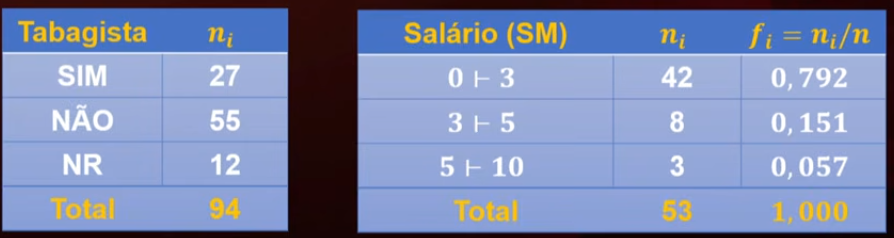

# Objetivos de aprendizagem

Ao final dessa semana, você deverá ser capaz de:

-   construir uma distribuição de frequências para um conjunto de dados quantitativos;
-   construir corretamente um histograma para representar a distribuição de frequências através da escolha adequada do número e amplitude dos intervalos de classe;
-   descrever as principais medidas de posição (média, mediana e moda) e de dispersão (amplitude total, desvio padrão) e realizar seu cálculo diretamente a partir dos dados e das distribuições de frequências.

## Distribuição de frequência

É uma tabela na qual os valores dos dados são agrupados em classes ou intervalos juntamente com a contagem do número de incidência em cada classe ou intervalo

ni = incidência

## Para contruir uma distribuição de frequências:

-   Decidir em quantas classes vamos agrupar os dados;
-   Encontrar uma amplitude de classes conveniente;
-   Determinar os limites inferior e superior das classes devem cobrir toda a amplitude dos dados sem sobreposição;
-   Contar quantos dados incdem em cada classe;
-   contruir a tabela de frequência sem esquecer nenhum elmento -> incidências, frequências relativas, densidades de frequências, linhas totais. 
    -   *A densidade de frequência é a medida estatística que indica a concentração de dados em um intervalo de classe, calculada dividindo-se a frequência (absoluta ou relativa) pela amplitude (largura) desse intervalo*