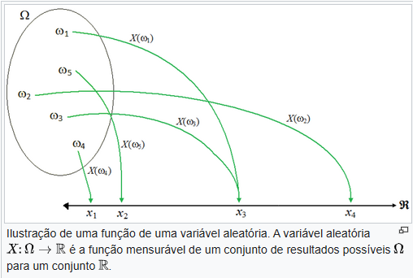
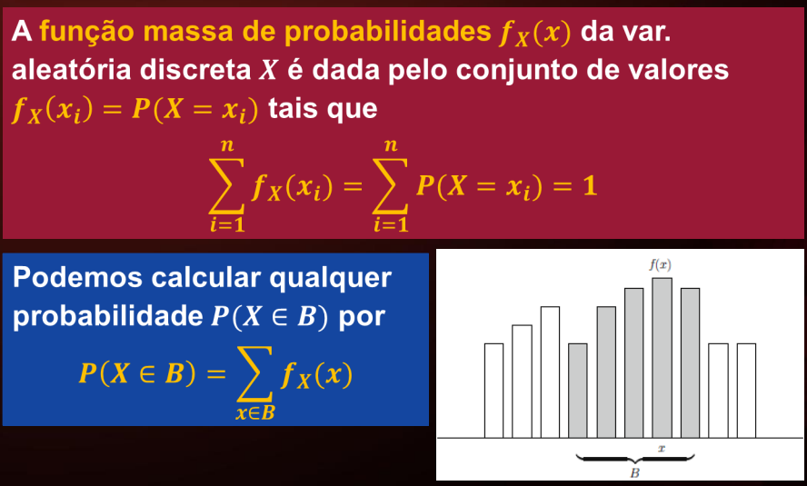
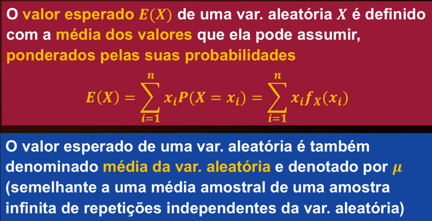
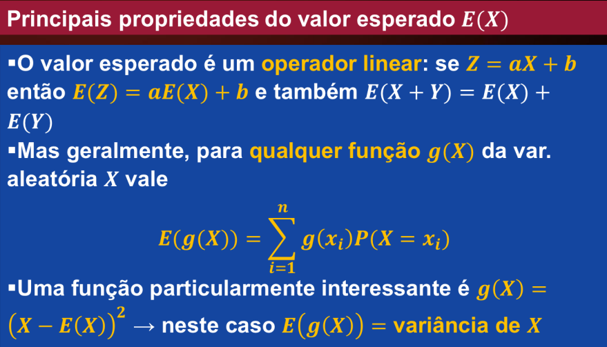

# Variáveis aleatórias discretas

Nesta semana começamos nosso estudo de variáveis aleatórias, em particular das variáveis aleatórias discretas, suas propriedades básicas e algumas aplicações. Discutiremos também duas grandezas muito importantes usadas para caracterizar variáveis aleatórias: seu valor esperado (ou média ou esperança) e sua variância (ou desvio quadrático médio).

Intuitivamente, uma variável aleatória "mede" uma grandeza observada em um experimento aleatório. Se Ω
 for um espaço amostral e o resultado do experimento aleatório é ω
, um "processo de medição" é realizado para obter um número X(ω)
. Assim, uma variável aleatória é na verdade uma função a valores reais em um espaço amostral, X:Ω→R
. As "medições" de X
 geralmente levam a afirmações da forma a≤X<b
, e é natural perguntar sobre a probabilidade de que X
 esteja entre a
 e b
 em uma determinada realização do experimento aleatório. Veremos que os valores de P(X≤b)
 definem uma função que caracteriza completamente a variável aleatória X
: sua distribuição de probabilidades.

## Objetivos de aprendizagem

Ao final dessa semana, você deverá ser capaz de:

-   Compreender o conceito de variável aleatória como uma função de Ω em R;
-   Identificar uma variável aleatória a partir de sua descrição como uma “medida” realizada sobre os possíveis resultados de um experimento aleatório;
-   Conhecer as distribuições de probabilidades para as variáveis aleatórias discretas mais simples;
-   Compreender o conceito de valor esperado (ou esperança) e de variância de uma variável aleatória discreta e ser capaz de calculá-los nos casos mais simples.

## Video aula 9 - Variáveis aleatórias e valores esperados

Uma varia´vel aleatória descreve o resultado de um experimento aleatório em termos de número. 

matematicamente, uma variavével aleatória é uma função.

X:  $\Omega$ -> R 

Na probabilidaade e estatística, uma variavel aleatória vai ser sempre um numero real, essa função transforma um conjunto em um numero, na variável aleatória entra um conjunto e sai um numero real.  

### Motivações para usar variaáveis aleatórias. 

- É <mark>mais facil e rápido</mark> descrever um resultado como uma variável aleatporia, com um valor específico, do que descrever esse resultado em palavras.
- A distribuiçõa de probabilidade da variável aleatória é uma função numérica -> <mark>mais fácil de lidar com números do que com conjuntos (eventos)</mark>
- A <mark>probabilidade de qualquer evento</mark> pode ser encontrada a partir da <mark>distribuição de probabilidade</mark> da variável aleatória usando as regras da teoria das probabilidades. 

#### Exemplos de variáveis aleatórias

- O número de peças defeituosas em um lote de produção
- O número de bugs em um programa de computador
- A quantidade de chuva (precipitação) em um determinado local, durante o mês de janeiro. 
- O tempo que um cliente aguarda em uma fila.

<mark>Variáveis aleatórias podem ser discretas (dois primeiros exemplos acima) ou continuas (dois últimos exemplos acima) </mark>

### variável aleatória discreta

Se os **resultados possíeveis** do experimento aleatório são **Números distintos separados uns dos outros** ( por exemplo, contagens ), então dizemos que a **variável aleatória é discreta**

- lançamento de um dado: podemos associar uma variável aleatória X ao valor da face observada. 
X = "face observada"

- Lançamento de uma moeda: podemos associas uma variável aleatória Y: {K, C} -> R Pelas definições 

Y(K) = 0, Y(C) = 1

* **O lançamento do dado** é chamado de **experimento aleatório** (ou experimento probabilístico), pois é a ação sujeita ao acaso cujo resultado não se pode prever com certeza antes de sua realização.
* **A face que fica voltada para cima** é o **resultado** (ou evento elementar) observado ao executar o experimento.
* **O conjunto de todas as 6 faces possíveis** — neste caso, o conjunto \\(\{1, 2, 3, 4, 5, 6\}\\) — é o **espaço amostral**.
* **Um evento** é qualquer **subconjunto** do espaço amostral. Por exemplo:
  * O evento de *"obter a face 5"* (representado pelo subconjunto \\(\{5\}\\)).
  * O evento de *"obter um número par"* (representado pelo subconjunto \\(\{2, 4, 6\}\\)).

---

Ótimo! Vamos usar um exemplo prático e simples para consolidar essa diferença.

---

### **Exercício de Fixação**

**Cenário:**  
Imagine que você possui uma urna contendo **10 bolas numeradas de 1 a 10**. Você coloca a mão na urna, retira uma bola ao acaso e observa o número marcado nela.

**Classificação dos elementos:**

1. **O ato de retirar a bola da urna e anotar o valor:**
   * **Conceito:** **Experimento Aleatório**
   * **Por quê?** É a ação sujeita ao acaso. Você não pode prever com certeza absoluta qual bola sairá antes de realizar a retirada.

2. **O conjunto de todas as bolas possíveis** $\Omega$ = {1,2,3,4,5,6,7,8,9,10}
   * **Conceito:** **Espaço Amostral**
   * **Por quê?** É o conjunto universo que reúne **todos** os resultados possíveis que o experimento pode produzir.

3. **Obter um número maior do que 7, ou seja, o subconjunto** A = {8, 9, 10}:
   * **Conceito:** **Evento**
   * **Por quê?** É um **subconjunto** do espaço amostral contendo apenas os resultados que satisfazem a condição de interesse.

---

### **Cálculo da Probabilidade desse Evento**

A probabilidade P(A) é dada pela razão entre o número de casos favoráveis e o total de casos possíveis do espaço amostral:

* **Casos favoráveis (tamanho do evento A)**: 3(8,9,10)
* **Casos possíveis (tamanho do espaço amostral** $\Omega$): 10

P(A) = Casos Favoráveis / Casos Possíveis = 3/10 = 0,30 (30%)

---

O que significam os símbolos?

- $\Omega$ (Ômega): É o espaço amostral, ou seja, a lista com todos os resultados possíveis de um experimento.
- $\omega$ (ômega minúsculo): É um resultado específico dentro desse espaço amostral.
- (X): É a Variável Aleatória. Pense nela como uma "regra" ou função que traduz o resultado do mundo real $\omega$ em um número.
- (x): É um valor numérico específico que você está testando.

### Distribuição de probabilidades

Da uma variável aleatória X, se pudermos <mark>especificar todas as probabilidade envolvendo X</mark> dizemos que determinamos a <mark>distribuição de probabilidade de X</mark>

<mark>distribuição (cumulativa) de probabilidades:</mark> função F: $\mathbb{R}$ -> [0,1] dada por Fx(x) = P(X $\le$ x), x $\in$ $\mathbb{R}$

A distribuição de probabilidades Fx(x) possui as seguintes **propriedades**

- Fx(x) é **limitada**: 0 <= fx(x) <= 1
- Fx(x) é **crescente**: se x <= x' então Fx(x) <= fx(x)
- Fx(x) é **contínua à direita**: lim(h -> 0+
) Fx(x + h) = Fx(x)

Se X possui distribuição de probabilidade Fx(x), então:
P(a < X <= b) = Fx(b) - Fx(a)

### Função massa de probabilidade
A **fução massa de probabilidades fx(x)** da variável aleatória discreta X é dada pelo conjunto de valores fx(x(i)) = P(X = x(i)) tais que

### valor esperado de uma varável aleatória

## Diferença entre variável aleatória discreta e contínua

A principal diferença é que a variável aleatória discreta assume valores contáveis (resultados de contagens, como 0, 1, 2...), enquanto a variável aleatória contínua assume qualquer valor dentro de um intervalo real (resultados de medições, como peso, altura ou tempo).
Segundo a Escola EDTI e conceitos fundamentais de estatística, as principais diferenças incluem:

Variável Aleatória Discreta

• Origem: Obtida por meio de contagem.
• Valores possíveis: Finitos ou enumeráveis (ex: \(0, 1, 2, 3...\)).
• Exemplos: Número de filhos, quantidade de peças defeituosas em um lote, número de reclamações por semana.
• Probabilidade de um valor exato: É positiva e calculável (ex: qual a probabilidade de saírem exatamente 2 defeitos?).

Variável Aleatória Contínua

• Origem: Obtida por meio de mensuração ou uso de instrumentos (régua, balança, cronômetro).
• Valores possíveis: Infinitos e pertencentes a um intervalo contínuo dos números reais (ex: entre 0 e 10).
• Exemplos: Peso de um animal, altura de uma pessoa, temperatura, tempo de ciclo de uma máquina.
• Probabilidade de um valor exato: É sempre zero; a probabilidade só pode ser calculada para uma faixa ou intervalo

[Material base](https://pt.wikipedia.org/wiki/Vari%C3%A1vel_aleat%C3%B3ria)